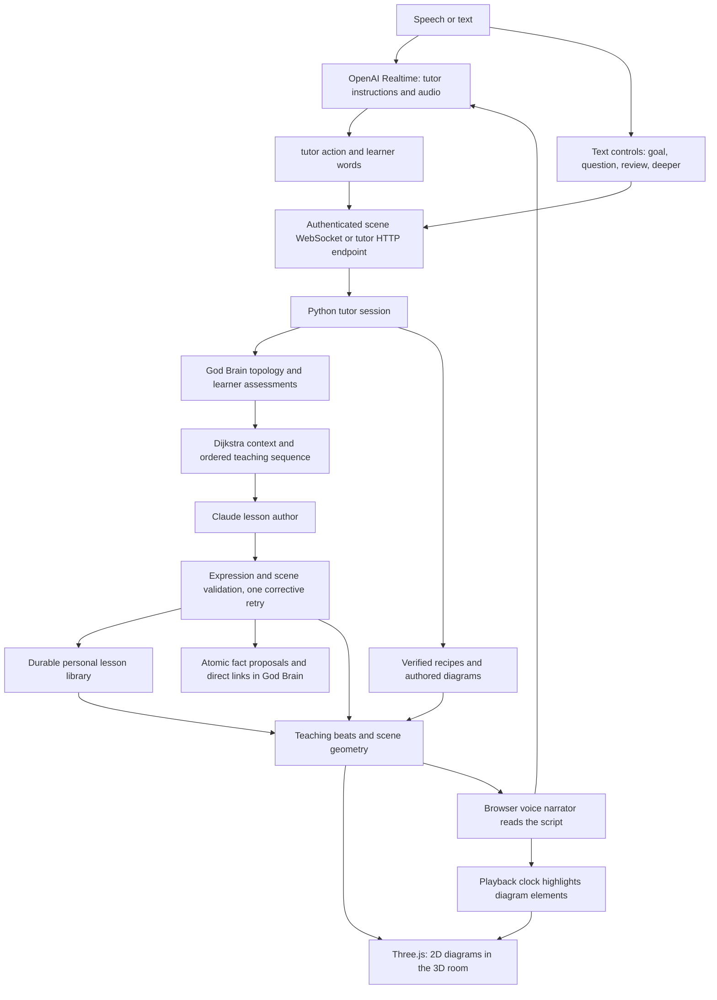

# Voice, memory and visual teaching

The voice bot has a tutor prompt. It is an audio interface to the backend tutor, which owns
lesson selection, graph context, grading and diagrams. It does not start with a copy of the
learner's brain. After a tool call it receives the generated teaching script, pending-question
state, goal and graph context. The lesson writer receives graph context before writing.

## API responsibilities

| Path or component | Responsibility |
| --- | --- |
| `POST /api/voice/sessions` | Returns a short-lived OpenAI credential and WebRTC SDP URL; the permanent provider key stays on the server. |
| Browser WebRTC | Carries microphone audio and spoken responses directly between browser and OpenAI. |
| `voice.py:INSTRUCTIONS` and `TOOLS` | Tell Realtime it is LUCID's voice and require the `tutor` tool for teaching and grading. Include explicit review and deeper actions. |
| `/ws/scenes` with `type: tutor` | Main teaching transport. Authenticates the learner and submits action, text and expected scene epoch. |
| `POST /api/lessons/{id}/tutor` | Equivalent HTTP tutor transport. |
| `tutor.py` | Resolves or creates concepts, diagnoses, requests teaching, grades checks and handles detours or learner-directed review. |
| `goals.py:teaching_context` | Finds nearby concepts and a bridge using weighted Dijkstra. |
| `author.py:ClaudeAuthor.explain` | Receives topic definition, learner request, nearby knowledge and ordered teaching sequence; returns diagram, spoken beats, check and atomic facts. |
| `diagrams.py` and `expressions.py` | Validate the diagram and symbolic expressions and compute allowed geometry. |
| `library.py` | Saves the latest generated explanation and check per learner and concept, before transient tutor prompts are added. |
| `GET /api/users/{id}/lessons` | Lists that learner's saved lesson concept IDs. Other users cannot read the list. |
| Scene turn with `concept` | Loads an authored lesson, reuses a saved generated lesson, or authors a lesson for an existing shared concept. |
| Scene turn with free text | Preserves the lower-level parameterized recipe planner API. The frontend's Explore form uses the conversational tutor so new topics can grow the graph. |

## How the graph informs teaching

The shared God Brain holds concept definitions and inherent similarity. A Human Brain holds
the learner's assessed understanding and personal edge familiarity. Neither a similarity
rating nor an understanding rating is itself the weight passed to Dijkstra. The active
methodology computes a separate traversal cost; the baseline is
`1 / (similarity * (understanding_a + understanding_b) + epsilon)`. Familiarity is stored
but is not an input to the baseline cost. This change leaves the engine formula intact.

There are two kinds of routes:

1. **Assessed learning route:** the existing engine shortest path across personal edges,
   starting from known concepts (understanding at least 7), with curriculum foundations as
   a fallback. This selects the next teaching step after diagnosis and is recalculated as
   answers change understanding. It now also accepts concepts outside the fixed curriculum.
2. **Planning context:** a read-only Dijkstra search outward from the teaching target across
   shared topology, using the learner's actual scores wherever present. Unassessed concepts
   use a temporary conservative value of 1 for cost calculation and remain explicitly null
   in the returned context. This permits planning through concepts the learner has never
   encountered without creating fake assessments or personal edges.

Context includes the twelve nearest reachable concepts, their descriptions and actual
understanding, an ordered sequence from the closest reachable known anchor to the target,
recently covered topics and the learner's goal. When teaching a prerequisite, the writer
also receives the sequence toward the overall goal. Disconnected known topics do not enter
the nearby context. The sequence is capped at 32 concepts with an explicit truncation flag.
If no known anchor is reachable, a reachable curriculum foundation is used; if none exists,
teaching begins at the target. The search loads at most the engine's 100,000-node and
500,000-edge snapshot limits; these are limits on the graph, not on the number sent to a model.

The writer is instructed to bridge from familiar knowledge through this sequence, teach
the current step with a diagram, and honor requests to review or extend a known topic.
A shortest path is a useful teaching backbone; the undirected graph does not encode every
required prerequisite in a dependency DAG. Diagnosis and clarification detours still handle
missing knowledge that a single path does not capture.

## Learner control and autonomous additions

Previously, a route with status `known` ended teaching immediately. Starting a goal that is
already known now reopens teaching. Explicit `review` and `deeper` actions work at any point;
common requests such as "learn more" are intercepted before quiz grading. Continue after
completion reopens a deeper explanation. A correct initial diagnostic may still complete
the initial route, but it never prevents the learner from reopening the topic.

Previously, a free question called the author directly, favoring the current concept, and
discarded the result after rendering. Free questions and exploration now resolve the actual
topic, create it when necessary and save generated teaching. Exact concept names and specific
new requests take precedence over broad curriculum substring aliases, so "even functions"
can become a distinct concept rather than silently matching "Functions".

Generated explanations can propose up to six standard, reusable facts actually taught.
Definitions can include small mathematical identities and their conditions, such as
`f(-x) = f(x)` for even functions on a symmetric domain. Names are deduplicated without regard
to case. Facts and links between them are accepted together through the memory engine's
revision-checked, audited proposal API, with model provenance. Existing edges are preserved.
The saved lesson and fact proposal share a transaction. Selection of an extracted fact authors
its focused lesson on demand. Generated facts are model-authored and are not independently
verified mathematical proofs.

The library records exposure separately from understanding. Viewing a diagram, asking a
question, or saving a fact cannot mark the learner as knowing it. Only graded answers and
explicit self-ratings update personal scores. Generated lesson artifacts are scoped to the
learner; shared concept definitions are scoped to the God Brain. Artifacts survive a backend
restart; live conversational sessions and scene epochs remain process-local.

## Voice and diagram synchronization

Claude returns spoken beats referencing diagram element IDs. The backend compiles the
diagram to scene objects, then the browser replaces the scene and sends the spoken script
to Realtime. The browser schedules highlights from audio playback start, estimates beat
boundaries using speaking rate, and recalibrates that estimate from completed playback.
Sliders update symbolic geometry locally without another model call.

Geometry can be planar or genuinely spatial: depth-aware curves, arrows, points and labels,
three labeled axes and bounded parametric surfaces. The full graph of a complex-valued
function needs four real coordinates; the quadratic recipe explicitly encodes its real output
against the complex input plane in three coordinates and marks roots satisfying both output
conditions. It never claims that every zero of the real output is a complex root.

Desktop TransformControls move/rotate a whole model or selected object. VR grip and supported
hand pinch attach the model/object to the controller while preserving its world transform;
release reparents it in place. Exclusive ownership prevents two controllers from moving the
same object or a parent/child pair simultaneously. Disconnect, scene rebuild and disposal
release grips safely. Local placement survives highlights, sliders and steps for the same
concept; changing concepts resets placement. Moving the display does not change its equations.
Beat highlighting remains an audio-clock estimate, not word-level alignment.

Without Claude, authored diagrams and verified recipes remain usable, saved generated lessons
can be replayed, and unknown concepts cannot be newly authored. Without OpenAI, the same tutor
works through text controls. Validation failures receive one corrective author retry and then
fall back to available teaching. No live-provider or physical-headset acceptance is implied
by the automated tests.

## Active learning and memory scheduling

The teaching loop is now **small step → prediction/explanation → corrective feedback → next
step → concept check → synthesis when applicable → teach-back**. There is no automatic
continuation past a pending question, including from silence in voice mode. Future focused
geometry is initially hidden. The author is asked to keep each beat to one inferential step;
authored fallback lessons use one small prediction and explicit pauses for self-explanation.
Unsuccessful microchecks get one corrective retry, and asking for help is never penalized.

Synthesis uses only actual, direct shared graph edges to concepts assessed as known (at least 7).
Missing personal links, and older links created only by `derived_min_understanding`, are
eligible. The assessment changes edge familiarity, not shared similarity. No path, or a
longer indirect path, triggers a concept-specific teach-back instead of an invented link.
Teach-back and active recall use an answer-independent rubric, generated before the response,
and an LLM score with partial credit and specific demonstrated/missing criteria. The score
becomes personal understanding. Failed provider grading is ungraded and leaves both mastery
and review state untouched. The learner can retry, request review or skip.

These choices implement retrieval practice, generation, explanatory questioning, feedback,
manageable steps and interleaving. Practice testing and distributed practice have especially
strong evidence in the [Dunlosky et al. research review](https://www.psychologicalscience.org/publications/journals/pspi/learning-techniques.html).
Retrieval practice can also support conceptual understanding, as examined in
[Karpicke and Blunt's experiment](https://learninglab.psych.purdue.edu/downloads/2011/2011_Karpicke_Blunt_Science.pdf).
This is a learning-science-informed design; it does not measure a user's brain activity or
guarantee a particular learning outcome. Summarizing while looking at the answer is different
from a closed-book teach-back, so recall prompts deliberately withhold the preceding lesson.

Spaced repetition uses the maintained [Python FSRS implementation](https://github.com/open-spaced-repetition/py-fsrs),
pinned at 6.3.2. See also [Anki's explanation of scheduling](https://docs.ankiweb.net/faqs/what-spaced-repetition-algorithm).
Difficulty, stability and current retrievability are kept separate from concept mastery and
graph edge cost. The default target recall is 90%, with the library's default parameters.
The app does not yet fit personalized parameters from review history. The next review date is
a model recommendation; the forgetting score is `1 - estimated retrievability`, not measured
forgetting. Existing concepts without a scored review start due with unknown recall probability.

On connection, `GET /api/me/reviews` powers the learning-day choice between a new topic and an
optional warm-up. Warm-ups select up to five due concepts and interleave nonadjacent subjects
when possible. `recall` can also test a chosen topic at any time. Final post-teaching assessments
and teach-backs are limited to FSRS Good rather than Easy because immediate fluency is weaker
retention evidence than delayed recall. Microchecks are logged as practice but do not update
FSRS stability. A failed recall schedules relearning; skipping or viewing does not change the
schedule. Review state, rubric evidence and attempt counts are persisted in user-scoped backend
tables in the same database. Raw learner answers are not retained in these practice logs.

Tutor turns serialize through the lesson's lock and recheck their expected epoch before
acting. Session state is staged until scene commit; scoring rechecks the epoch after provider
grading. An interruption during grading cannot silently consume the question or award mastery,
and two queued answers at one epoch cannot accidentally grade two successive questions.
